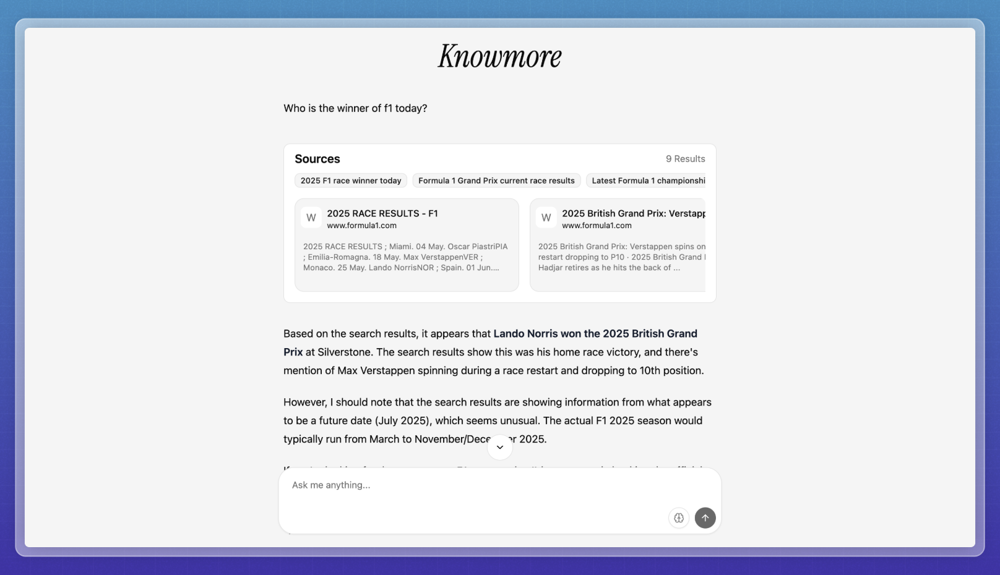

# Knowmore

**Knowmore** is a clone of Perplexity AI, it has a lot of thing missing features. The goals for this project is to learn django and RAG architecture.



## Demo

Watch the YouTube demo: https://www.youtube.com/watch?v=_mFrt65fLQA

## Requirements

- Python >= 3.10
- Node.js/Bun
- Docker (optional)

**Environment Variables**:

```bash
ANTHROPIC_API_KEY=
OPENAI_API_KEY=
FIRE_CRAWL_API_TOKEN=
SECRET_KEY=
```

## Integration

For now it integrates with Anthropic AI. Soon will be adding OpenAI GPT-4 and other LLMs.

### Optional Parallel web search

Use [Parallel Search MCP](https://docs.parallel.ai/integrations/mcp/search-mcp)
for free web search without a search API key or Parallel account. Add this to
your `.env`, install the Python requirements, and restart the backend:

```bash
WEB_SEARCH_PROVIDER=parallel
```

Ask a question in the chat that needs current sources; the chat enables web search.
Parallel's anonymous endpoint uses Fast mode and returns relevant page excerpts;
these excerpts appear as sources and provide context for the answer. This provider
uses excerpts rather than scraping full pages. Free access has usage limits and
is intended for exploration and light use.

`ANTHROPIC_API_KEY` is still required for Knowmore's search-query generation,
along with the credentials for your selected answer model. Neither `EXA_API_KEY`
nor `FIRE_CRAWL_API_TOKEN` is needed when Parallel is selected. Leave
`WEB_SEARCH_PROVIDER` unset to keep the existing behavior: Exa when `EXA_API_KEY`
is configured, otherwise Firecrawl. API clients can still disable search with
`enable_web_search: false`.

## Quick Start

### Using Make (Recommended)

Build and run the full application:
```bash
make dev
```

This will:
- Build the frontend using `./build_frontend.sh`
- Build the Docker image
- Run the backend on port 7000

Individual commands:
```bash
# Build frontend and backend
make build

# Serve frontend only (for development)
make serve-ui

# Build Docker image only
make backend

# Run backend container only
make run-backend
```

### Manual Setup

Install Python packages:
```bash
pip install -r requirements.txt
```

Install frontend dependencies:
```bash
cd frontend && bun install
```

Run Python server:

For development (no streaming support):
```bash
python manage.py runserver
```

For proper SSE streaming support (recommended):
```bash
python run_asgi.py
# or
daphne -b 127.0.0.1 -p 8000 Knowmore.asgi:application
```

### Using Docker

Build Docker image:
```bash
docker build . -t knowmore
```

Run Docker container:
```bash
docker run --env-file .env -p 7000:8000 knowmore
```

Access the application at: http://localhost:7000

## Credits

This project is inspired by this company.

- [Devv AI](https://devv.ai/)
- [Perplexity](https://www.perplexity.ai/)
